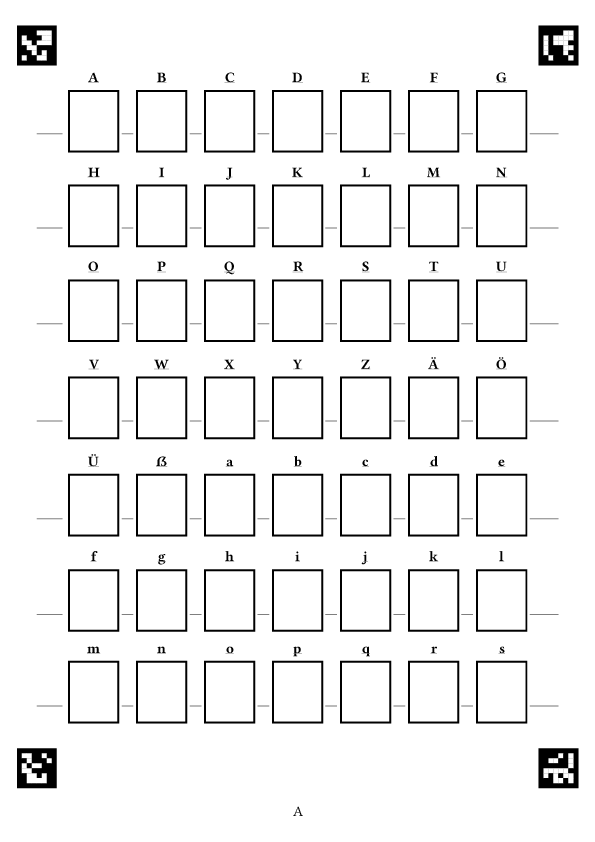
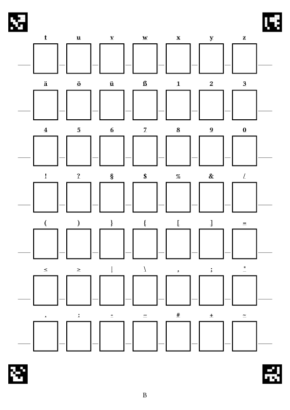
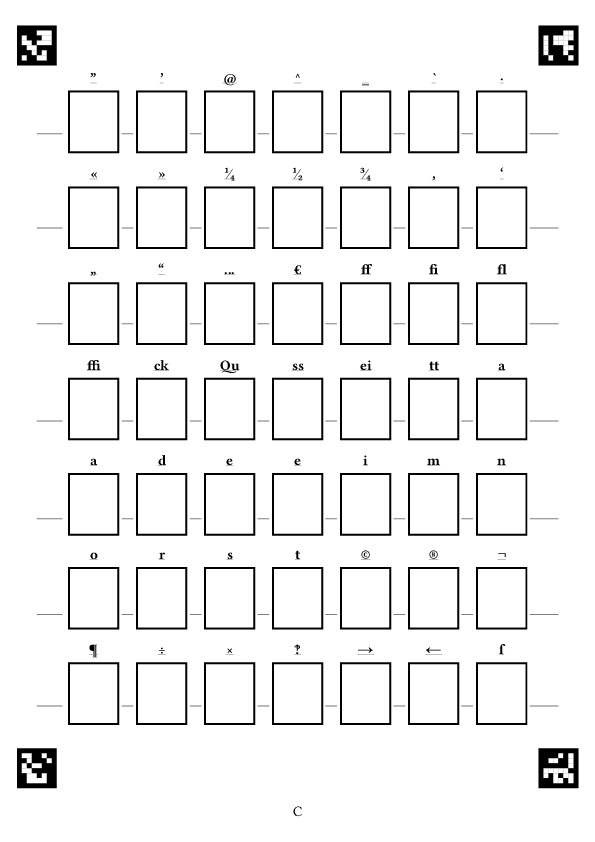
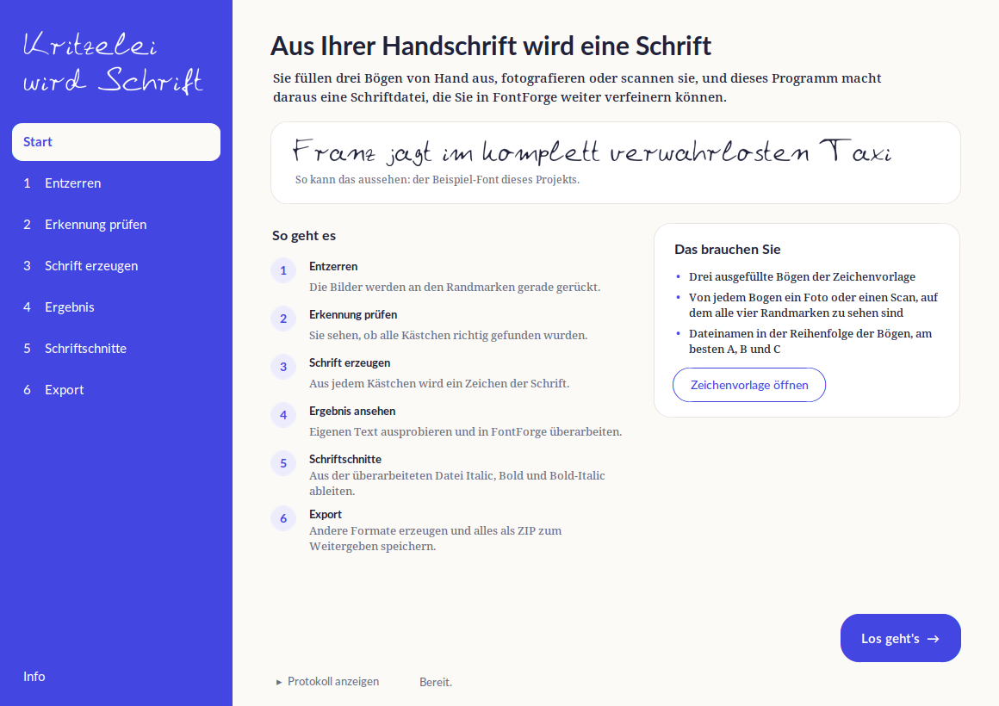
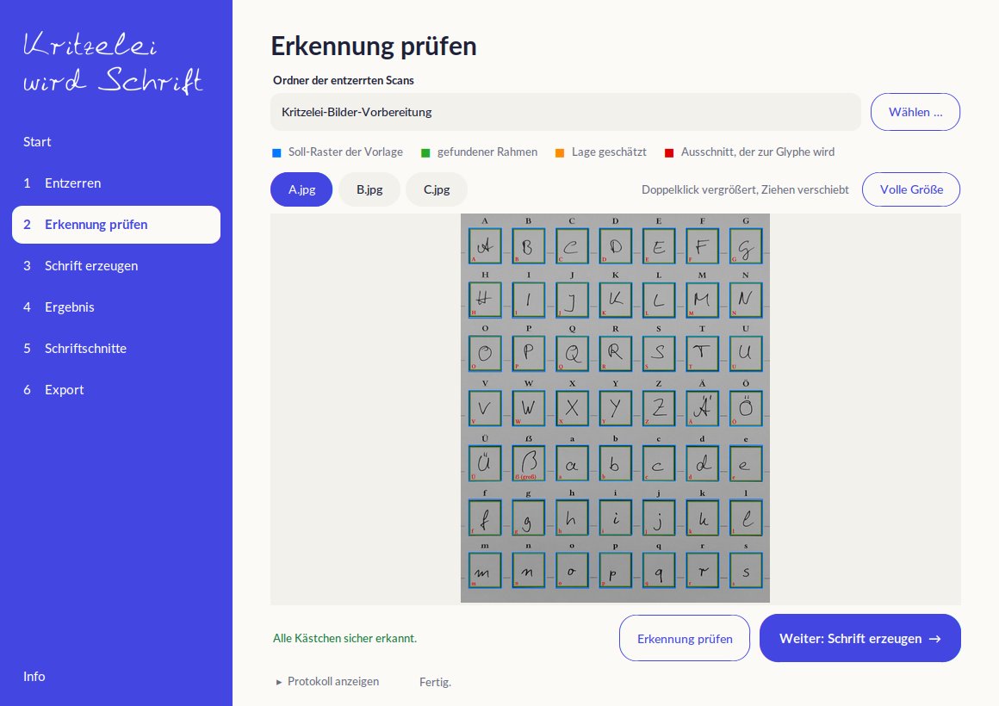
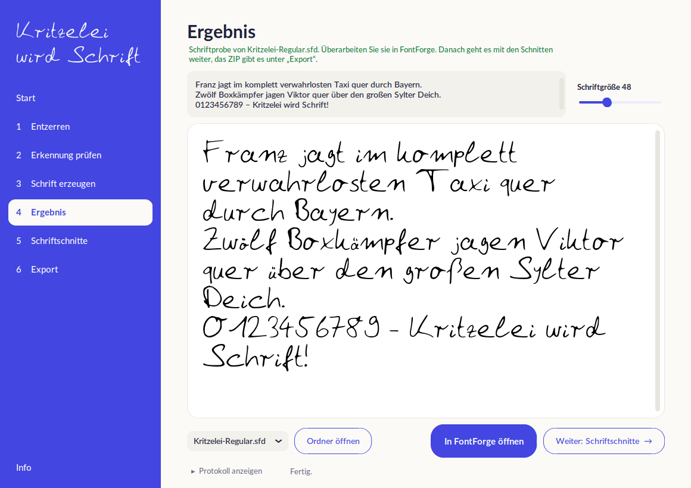
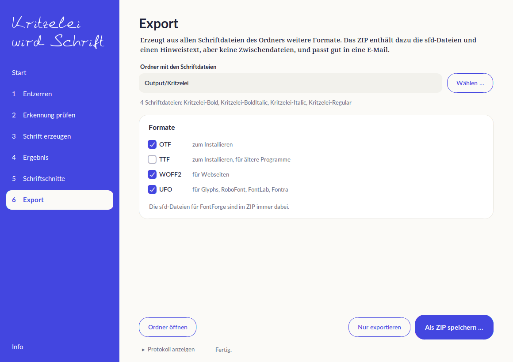
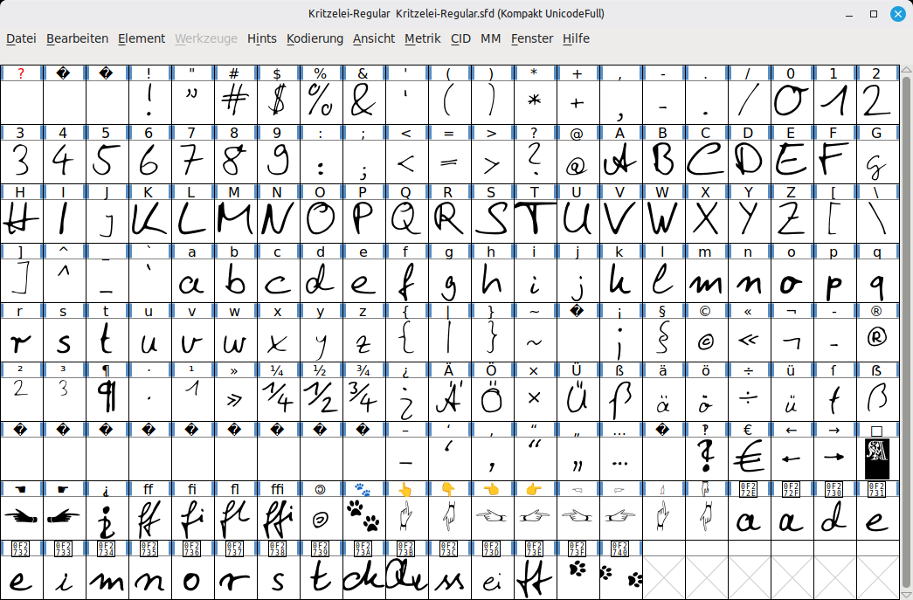

[//]: # (
  pandoc --from=markdown README.md \
  --to=html5 --output=index.htm -s \
  --include-in-header=template/Kritzelei-wird-Schrift-meta.htm
  )

# *Kritzelei wird Schrift*

*Kritzelei wird Schrift* (seit Dezember 2021) ist die Weiterentwicklung von [Hand2Font](https://maybegeek.github.io/Hand2Font/) (seit Juni 2019).

Von handgekritzelten Zeichen zum weiterbearbeitbaren Font. Drei Blatt mit je 49 Kästchen stehen bereit für die jeweiligen Zeichen. Sind die Kästchen ausgefüllt, können die Bögen per Foto oder Scan umgewandelt werden.

* Die Zeichen sollten möglichst innerhalb der Kästchen bleiben. Ein Strich, der den Rahmen berührt oder kreuzt, bringt die Erkennung zwar nicht komplett durcheinander, der Teil außerhalb des Kästchens fehlt aber dann in der Glyphe.
* Die vier Randmarken müssen auf dem Bild/Scan ebenfalls vollständig vorhanden sein.
* Bei ungünstiger Belichtung oder ungünstiger (kontrastarmer) Papierfarbe-Schriftkombination kann jederzeit mittels eines Bildbearbeitungsprogramms -- in einem Zwischenschritt -- per `threshold`/Schwellwert eine Umwandlung in Schwarz-Weiß manuell durchgeführt werden und die Erkennung in den nächsten Schritten dadurch verbessert werden.
* Als Bilddateien eignen sich `jpg`, `jpeg` und `png`, die Schreibweise der Endung spielt keine Rolle.
* Am sichersten ist das Namensmuster `A.jpg`, `B.jpg` und `C.jpg`. Die Namen sind zwar frei, die Bögen werden aber nach ihrem Dateinamen sortiert: Die erste Datei gilt als Bogen A, die zweite als B, die dritte als C. Das Programm kann die Bögen selbst nicht unterscheiden, bei falscher Reihenfolge landen die Zeichen also an den falschen Stellen.
* Falls Sie die Umwandlung von jemand anderem Durchführen lassen notieren Sie noch in einer Datei `Schriftname.txt` den Wunschnamen der Schrift.

Für die Weiterverarbeitung gibt es ein Skript zum Entzerren und Zuschneiden der Glyphen-Vorlage. Hernach werden die Kästchen per `opencv` erkannt, der Inhalt der Boxen dann ausgeschnitten und die vorliegenden Einzelbilder der Kästcheninhalte in `*.ppm`-Dateien umgewandelt um diese dann per `potrace` zu vektorisieren. Die erstellten `*.svg`-Dateien werden im nächsten Schritt an vorgesehenen Positionen im `Font` platziert und eine `*.sfd`-Datei erstellt.

Die automatische Umwandlung der Zeichen soll einige Schritte bei der Erstellung einer eigenen Schrift mit `Fontforge` beschleunigen -- es bleibt aber noch genügend (Fein-)Arbeit für die Verbesserung der automatisch erstellten `*.sfd`-Datei.

## Kritzelei-Zeichenvorlage

::: {.glyphenvorlage}

:::

::: {.download}

[Kritzelei-Zeichenvorlage.pdf](https://maybegeek.github.io/Kritzelei-wird-Schrift/Kritzelei-Zeichenvorlage/Kritzelei-Zeichenvorlage.pdf){.button}

:::

## magic

Bei der Erstellung des Fonts werden bzgl. der eigenen Zeichen noch weitere Einstellungen und Umwandlungen vorgenommen:

* der Zeichensatz festgelegt: `UnicodeFull`
* Versionsnummer für den Font vergeben: `1.0`
* font weight: `Regular`
* `fontname`, `familyname` und `fullname`
* `font.comment = 'FONT_COMMENT'`
* `font.copyright = 'FONT_LICENSE'`
* em-size: `2048`
* Layers: `cubic`
* `stylistic sets`
* `liga`, normale Ligaturen
* `dlig`, discretionary ligatures
* besondere Leerzeichen
* Katzenpfoten!
* `.notdef`-Quisquilie
* side bearings
* Größenanpassung ... automagisch
* Grundlinien- x-Höhen-Anpassung

## Nutzung

### mit der Bedienoberfläche

`python3 Kritzelei-Oberflaeche.py` öffnet ein Fenster, das nach einer Startseite in sechs Schritten durch die Umwandlung führt. Die Oberfläche braucht zusätzlich die Bibliothek CustomTkinter, siehe [notwendige Pakete](#notwendige-pakete). Das Fenster braucht einige Sekunden, bis es erscheint, und mindestens 1100 Pixel Breite.

Die Schritte lassen sich links jederzeit anwählen. Überall gilt dieselbe Regel: **Knöpfe ohne Pfeil tun etwas und bleiben auf der Seite, nur Knöpfe mit Pfeil wechseln die Seite.** Nach einem erfolgreichen Schritt erscheint „Weiter: …“ als Hauptknopf.

1. **Entzerren**: Ordner mit den Fotos/Scans (`jpg`, `jpeg`, `png`) und Zielordner wählen. Die gefundenen Bögen erscheinen als Karten, „Scans entzerren“ rückt sie gerade.
2. **Erkennung prüfen**: zeigt jeden Bogen mit den erkannten Kästchen (Farben wie bei der Fehlersuche, siehe unten). Ein Doppelklick vergrößert die angeklickte Stelle. Unten in jedem Kästchen steht, welches Zeichen dort erwartet wird.

   

3. **Schrift erzeugen**: Name, Zielordner, Stift, Strichbreite und die übrigen Einstellungen wählen. Der Zielordner folgt dem Namen (`Output/<Name>`), solange er nicht von Hand geändert wurde. Vor dem Überschreiben vorhandener Dateien wird nachgefragt.
4. **Ergebnis**: Schriftprobe mit eigenem Text, dazu die Knöpfe „In FontForge öffnen“ und „Ordner öffnen“. Jetzt ist die Zeit, die Regular-Datei in FontForge zu überarbeiten.

   

5. **Schriftschnitte**: aus der überarbeiteten Regular-Datei Italic, Bold und Bold-Italic ableiten, siehe [Schriftschnitte](#schriftschnitte).
6. **Export**: weitere Formate erzeugen und alles als ZIP zum Weitergeben speichern, siehe [Export](#export).

   

Links unten führt **Info** zu Projektinformationen, Links und Lizenz. Die Oberfläche ruft dieselben Skripte auf, die auch einzeln benutzt werden können. Das aufklappbare Protokoll unten im Fenster zeigt jeden Aufruf und alle Ausgaben und öffnet sich bei Fehlern von selbst, die Befehle lassen sich von dort auch in die Kommandozeile übernehmen.

### mit der Kommandozeile

In den Ordner `Kritzelei-Bilder-Original` kommen die Fotos/Scans der ausgefüllten `Kritzelei-Zeichenvorlage`.

Inhalt dann dort:

* `Kritzelei-Bilder-Original/A.jpg`
* `Kritzelei-Bilder-Original/B.jpg`
* `Kritzelei-Bilder-Original/C.jpg`

Mittels `python3 Kritzelei-Bilder-Vorbereitung.py -s Kritzelei-Bilder-Original` wird dann der Ordner nach Bilddateien (`jpg`, `jpeg`, `png`) inspiziert und die drei Dateien im Ordner `Kritzelei-Bilder-Vorbereitung` beschnitten und entzerrt abgelegt. Das Ergebnis ist unabhängig von der Endung der Quelle immer eine `.jpg`-Datei, ein neuer Lauf ersetzt also das alte Ergebnis.

Möglicher Inhalt dort:

* `Kritzelei-Bilder-Vorbereitung/A.jpg`
* `Kritzelei-Bilder-Vorbereitung/B.jpg`
* `Kritzelei-Bilder-Vorbereitung/C.jpg`

Auch die einzelne Umwandlung per `python3 Kritzelei-Bilder-Vorbereitung.py -f A.jpg` ist möglich, der Dateiname ist dann auf den Ordner `Kritzelei-Bilder-Original` bezogen. Mit `-o Ordner` lässt sich ein anderer Zielordner wählen, mit `--ohne-vorschau` werden keine Vorschaufenster geöffnet. Fehlt auf einem Bild eine der vier Randmarken, wird das gemeldet und das Bild übersprungen.

Wollen wir nachsehen, ob die Glyphen in den jeweiligen Kästen ordentlich und in ordentlicher Reihenfolge erkannt werden -- das ist ja durchaus sehr wichtig für den nächsten Schritt -- so können wir dies mit `python3 Kritzelei-Bilder-Fehlersuche.py -s Kritzelei-Bilder-Vorbereitung` tun.

Die Fehlersuche verwendet genau dieselbe Kästchenerkennung wie der nächste Schritt. Für jeden Bogen wird ausgegeben, ob alle Kästchen sicher erkannt wurden; unsichere Kästchen werden mit Nummer und Zeichen genannt. Im Fenster zeigt Blau das Soll-Raster der Vorlage, Grün den gefundenen Rahmen (Orange: Lage geschätzt) und Rot den Ausschnitt, der zur Glyphe wird. Unten in jedem Kästchen steht, welches Zeichen dort erwartet wird, etwa `ẞ (groß)`, `ck-Ligatur` oder `a Variante 2`. Der Vergleich mit der Zeichnung zeigt auch, ob die Bögen in der richtigen Reihenfolge liegen. Mit `ESC` (oder einer anderen Taste) geht es zum nächsten Bogen. Mit `--speichern Ordner` werden die markierten Bilder stattdessen als Dateien abgelegt.

Passt dies, geht es weiter. Grundlegend hier zwei Aufrufe, alle Einstellmöglichkeiten zeigt `python3 Kritzelei-wird-Schrift-Scan2SVG.py --help`:

Hier also die vorbereiteten Bilder aus `Kritzelei-Bilder-Vorbereitung` holen (A,B,C) und in den Ordner `Output/Kritzelei-01` mit Schriftnamen `Kritzelei-01` hinein umwandeln ... die Glyphenbilder, deren Umwandlung und eine weiterverwendbare `.sfd` erzeugen. `--rmppm`, `--rmsvg` oder `--rmjpg` entfernt nämliche Zwischenschrittdateien.

`python3 Kritzelei-wird-Schrift-Scan2SVG.py --scans Kritzelei-Bilder-Vorbereitung/ -o Output/Kritzelei-01 -n Kritzelei-01 --rmppm`

Ein bisschen mit den Optionen wird man schon spielen müssen, hier eine Variante, welche gerade bei bestimmten Stiftverwendungen und Stiftfarbenverwendungen erfolgreich ist. Aber auch hier nochmals der Hinweis, dass eine vorherige Bearbeitung hin zu kontrastreichem schwarz/weiß im Bildbearbeitungsprogramm hilfreich ist.

`python3 Kritzelei-wird-Schrift-Scan2SVG.py --scans Kritzelei-Bilder-Vorbereitung/ -o Output/Kritzelei-02 -n Kritzelei-02 --rmppm --buntstift`

Statt eines Ordners können die Bögen auch einzeln angegeben werden, fehlende Bögen werden dabei übersprungen: `-a A.jpg -b B.jpg -c C.jpg` (dann bitte mit `-o Ordner`).

Die Kästchenerkennung geht vom bekannten Raster der Vorlage aus und sucht jede Rahmenlinie nur in der Nähe ihrer erwarteten Lage. Das ist robust gegen Zeichen, die den Rahmen berühren, gegen ungleichmäßiges Licht und gegen leicht gewölbtes Papier. Kann eine Linie nicht gefunden werden, wird ihre Lage geschätzt und eine Warnung ausgegeben, statt abzubrechen.

`-o Ordner`: Ordnername und Ziel, in welchem die Dateien abgelegt werden (Standard: `<scans>/FONT`).

`-n KritzeleiFont`: Wie soll der Font später heißen? (Standard: `Kritzelei`)

`--blur 3`: Weichzeichner für die ausgeschnittenen Zeichen, ungerade Zahl, `0` = aus.

`--rmppm`: *.ppm-Dateien im Erstellungsordner entfernen.

`--rmjpg`: *.jpg-Dateien im Erstellungsordner entfernen.

`--rmsvg`: *.svg-Dateien im Erstellungsordner entfernen.

`--buntstift`: bei Buntstift, Farbe, uneinheitlicher Deckkraft, ... (potrace mit `--blacklevel 0.6` und `--alphamax 1.34`)

`--ptdefault`: statt `--buntstift`. potrace mit Standardeinstellungen, führt zu genauerer Umsetzung.

`--strichbreite-anpassen 0.75`: gleicht die Strichbreiten der Zeichen einander an, das geschieht auch ohne Angabe dieser Option. Ohne Anpassung werden die Striche im Font unterschiedlich dick, weil jedes Zeichen auf die Höhe seiner Klasse skaliert wird – ein klein gezeichnetes „o“ wird viel stärker vergrößert als eine groß gezeichnete Klammer. Vor dem Vektorisieren wird daher je Kästchen die Strichbreite gemessen, die spätere Skalierung vorhergesagt und der Strich entlang seiner Kontur so verdünnt oder verdickt, dass er im Font die Zielbreite erreicht. Der Charakter des Strichs bleibt dabei erhalten. Reine Punkte (`.`, `:` …) bleiben unverändert.
Der Anteil bestimmt die Stärke: Standard ist `0.75`, das gleicht Ausreißer aus und lässt dem Strich etwas Leben. `--strichbreite-anpassen 0.5` nähert nur zur Hälfte an, `--strichbreite-anpassen` ohne Zahl macht alle Striche gleich breit, `--strichbreite-anpassen 0` schaltet die Anpassung ab.

`--strichbreite 90`: Zielbreite in Font-Einheiten (em 2048) für die Anpassung (Standard: Median aller Zeichen; zum Vergleich: bei den Beispielbögen liegen die Breiten ohne Anpassung etwa zwischen 34 und 150). Ohne Angabe eines Anteils werden dabei alle Zeichen ganz angeglichen.

`--ohne-font`: nur die SVG-Dateien erzeugen. Der Font kann dann später separat erstellt werden:

`python3 Kritzelei-wird-Schrift-SVG2Font.py -svg Output/Kritzelei-01 -n Kritzelei-01`

Die erzeugte `*.sfd`-Datei wird anschließend in FontForge geöffnet und dort weiterbearbeitet und als OTF/TTF/WOFF2 exportiert.

### Schriftschnitte

Italic, Bold und Bold-Italic entstehen bewusst erst, nachdem die Regular-Datei in FontForge überarbeitet wurde. Ist etwa der Endstrich eines kleinen `e` zu lang, fällt die Korrektur so nur einmal an und nicht in vier Dateien.

`python3 Kritzelei-wird-Schrift-Schnitte.py -sfd Output/Kritzelei-01/Kritzelei-01-Regular.sfd`

Neben der Regular-Datei liegen danach `Kritzelei-01-Italic.sfd`, `Kritzelei-01-Bold.sfd` und `Kritzelei-01-BoldItalic.sfd`. Das sind automatisch abgeleitete Ausgangspunkte für die weitere Arbeit in FontForge, keine fertigen Schnitte: Kursiv ist schräg gestellt, Fett verstärkt den Strich gleichmäßig und lässt die Laufweiten unverändert. Enge Formen wie `@` oder `©` brauchen im fetten Schnitt oft Nacharbeit. Ligaturen, Stilsets und Kerning werden übernommen; das Kerning sollte geprüft werden. Die Hints berechnet das Skript für jeden abgeleiteten Schnitt neu, weil die der Regular-Datei nach dem Verstärken und Neigen nicht mehr passen; auch die Regular-Datei bekommt beim Erzeugen automatische Hints. Handarbeit an Hints in der Regular-Datei wird nicht in die Schnitte übernommen.

Die Metainformationen der Familie werden dabei passend gesetzt:

| Feld | Regular | Italic | Bold | Bold-Italic |
|---|---|---|---|---|
| FontName | `Name-Regular` | `Name-Italic` | `Name-Bold` | `Name-BoldItalic` |
| FullName | `Name Regular` | `Name Italic` | `Name Bold` | `Name Bold Italic` |
| Weight | Regular | Regular | Bold | Bold |
| ItalicAngle | wie Regular | Regular minus Neigung | wie Regular | Regular minus Neigung |
| StyleMap | `0x0040` | `0x0001` | `0x0020` | `0x0021` |
| TTFWeight | 400 | 400 | 700 | 700 |
| Panose | `3 0 5 0 …` | `3 0 5 0 …` | `3 0 8 0 …` | `3 0 8 0 …` |

`--schnitte Italic Bold`: nur diese Schnitte erzeugen (Standard: alle drei).

`--staerke 46`: so viel dicker wird der Strich, bezogen auf em 2048.

`--neigung 12`: so viele Grad zusätzliche Neigung für die kursiven Schnitte. Sie kommt zum Winkel der Regular-Datei hinzu, eine ohnehin geneigte Handschrift wird also entsprechend stärker geneigt.

`--nur-kennzeichen`: setzt nur die Metainformationen, die Umrisse bleiben unberührt. Das ist für schon von Hand gestaltete Dateien gedacht, sie müssen neben der Regular-Datei liegen. Die Regular-Datei wird dabei mit angepasst, ein von Hand gesetzter Neigungswinkel bleibt erhalten.

`--ueberschreiben`: ersetzt vorhandene Schnitte, sonst bricht das Skript ab, damit keine Nacharbeit verloren geht. Überschriebene Dateien bleiben als `*.sfd.bak` erhalten, allerdings nur die jeweils letzte Fassung.

### Export

`python3 Kritzelei-wird-Schrift-Export.py -d Output/Kritzelei-01 --zip Kritzelei-01.zip`

Die `*.sfd`-Dateien sind das Arbeitsformat für FontForge. Der Export erzeugt aus allen `*.sfd`-Dateien des Ordners weitere Formate und legt sie nach Zweck sortiert in `<Ordner>/export/` ab:

| Format | Unterordner | Zweck |
|---|---|---|
| `otf` | `installieren/` | zum Installieren und Benutzen |
| `ttf` | `installieren/` | ebenso, für ältere Programme; die kubischen Kurven werden umgerechnet |
| `woff2` | `web/` | zum Einbinden in Webseiten |
| `ufo` | `bearbeiten/` | zum Weiterarbeiten in anderen Programmen wie Glyphs, RoboFont, FontLab oder Fontra |

`--formate otf woff2 ufo`: welche Formate entstehen (Standard: diese drei).

`--zip Name.zip`: speichert zusätzlich ein Paket zum Weitergeben, etwa per E-Mail. Es enthält die `*.sfd`-Dateien, die gewählten Formate und den Hinweistext `LIESMICH.md`, aber keine Zwischendateien und keine `*.sfd.bak`-Sicherungen. Der Hinweistext passt sich an, je nachdem ob schon Schriftschnitte dabei sind; die Vorlage steht in `template/LIESMICH.md`.

Im UFO-Format landet das Kerning als Regeln in `features.fea` und nicht in `kerning.plist`, so legt es FontForge an. In den Kerning-Fenstern anderer Programme erscheint es deshalb vermutlich nicht als bearbeitbare Paare.

Pro Schrift sollte es einen eigenen Ordner geben, der Export nimmt alle `*.sfd`-Dateien darin.

## Aufbau des Codes

Die Skripte sind schlanke Aufrufe, die eigentliche Arbeit steckt im Ordner `kritzelei/`:

* `kritzelei/dateien.py`: welche Bilddateien eines Ordners als Bögen gelten
* `kritzelei/glyphen.py`: welches Zeichen in welchem Kästchen steht, ihre lesbaren Beschriftungen und die Höhenklassen für die Größenanpassung
* `kritzelei/bild.py`: Entzerren anhand der ArUco-Randmarken (OpenCV)
* `kritzelei/raster.py`: Kästchenerkennung über das Soll-Raster der Vorlage mit Feinjustierung je Rahmenlinie, dazu das Kontrollbild
* `kritzelei/vektor.py`: Ausschneiden der Zeichen und Vektorisieren mit potrace
* `kritzelei/strich.py`: Messen und Angleichen der Strichbreite (`--strichbreite-anpassen`)
* `kritzelei/font.py`: Aufbau der FontForge-Datei mit allen Zusätzen (magic)
* `kritzelei/symbole.py`: eingebettete Zeichen (Katzenpfoten, `.notdef`, Zeigehände)
* `kritzelei/schnitte.py`: Italic, Bold und Bold-Italic aus der überarbeiteten Regular-Datei
* `kritzelei/export.py`: weitere Formate und das ZIP zum Weitergeben
* `kritzelei/oberflaeche.py`: das Fenster der Bedienoberfläche (CustomTkinter)
* `kritzelei/auftrag.py`: übersetzt die Einstellungen der Oberfläche in Aufrufe der Skripte
* `kritzelei/schriftprobe.py`: Schriftprobe für den Ergebnis-Schritt
* `template/oberflaeche/`: Titel, Schriftprobe und Icon der Oberfläche; `doku/` enthält die Bildschirmfotos dieser Seite, `template/screenshots.py` nimmt sie neu auf (braucht ImageMagick)
* `template/LIESMICH.md`: Vorlage für den Hinweistext im ZIP

Tests mit den Beispielbögen: `python3 -m pytest tests`

## Ergebnis in FontForge

## Download

Hierzu am besten auf der [github-Seite zu Kritzelei wird Schrift](https://github.com/maybegeek/Kritzelei-wird-Schrift) die Projektdaten herunterladen:

::: {.download}

[Projektdateien für *Kritzelei wird Schrift* herunterladen](https://github.com/maybegeek/Kritzelei-wird-Schrift/archive/refs/heads/main.zip){.button}

:::

## notwendige Pakete

### unter Linux

* `potrace`
* `libfontforge3`
* `python3`
* `python3-skimage`
* `python3-fontforge`
* `python3-opencv`
* `python3-matplotlib`
* `python3-pil`
* `python3-tk` und `python3-pil.imagetk` (nur für die Bedienoberfläche)
* `fontforge` oder das Flatpak `org.fontforge.FontForge` (nur für den Knopf „In FontForge öffnen“; `fontforge-nox` hat keine grafische Oberfläche)
* `zenity` oder `kdialog` (empfohlen für die Oberfläche: Ordner- und Dateiwahl mit dem Dialog des Desktops, sonst mit dem älteren von Tk)
* `python3-pytest` (nur für die Tests)

Die Bedienoberfläche braucht außerdem CustomTkinter, das per `pip` installiert wird:

`/usr/bin/python3 -m pip install --user --break-system-packages customtkinter`

Trotz des Namens der Option landet das Paket nur im eigenen Benutzerordner. Der ausdrückliche Aufruf von `/usr/bin/python3` ist wichtig, wenn gerade eine virtuelle Python-Umgebung aktiv ist: Dort schlägt `pip3 install --user` fehl, und `python3-fontforge` steht in einer solchen Umgebung meist nicht zur Verfügung. Gestartet wird die Oberfläche dann entsprechend:

`/usr/bin/python3 Kritzelei-Oberflaeche.py`

Für die Oberfläche sind die Schriften Lato und Noto Serif vorgesehen; fehlen sie, wird eine installierte Ersatzschrift verwendet.

Getestet mit Python 3.12, OpenCV 4.6, FontForge 20230101 und CustomTkinter 6.0.0. Neuere OpenCV-Versionen (ab 4.7, geänderte ArUco-Schnittstelle) werden ebenfalls unterstützt.

Viel Vergnügen & happy fonting,  
Christoph Pfeiffer
